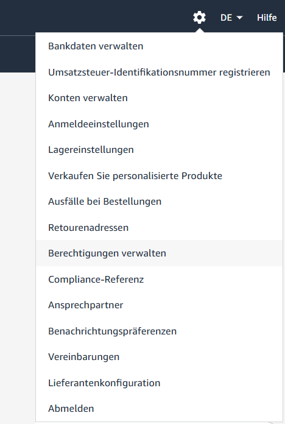
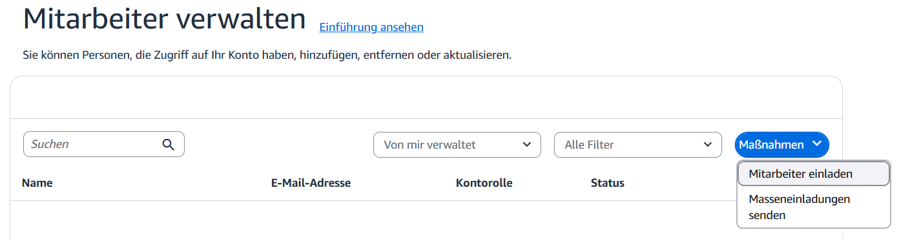
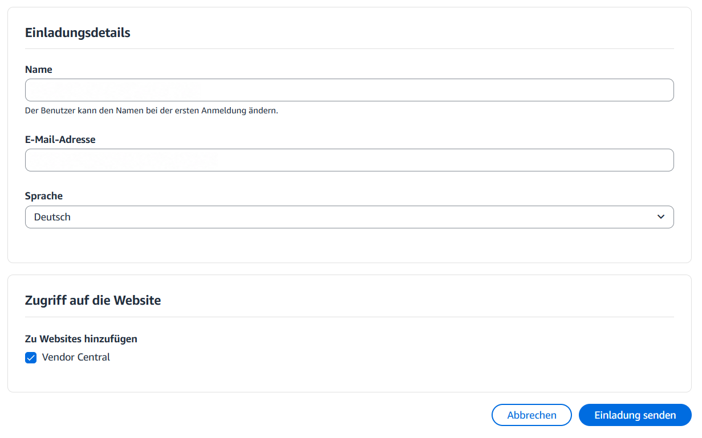
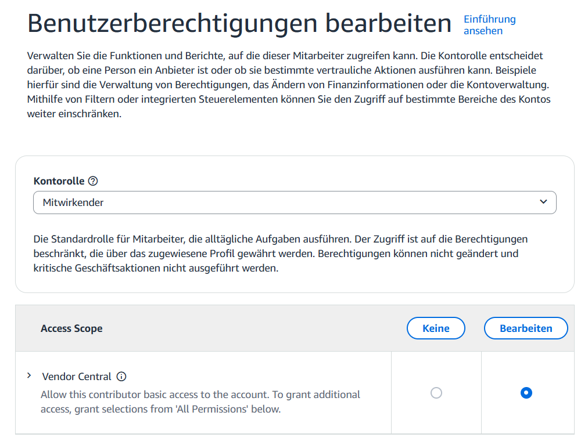
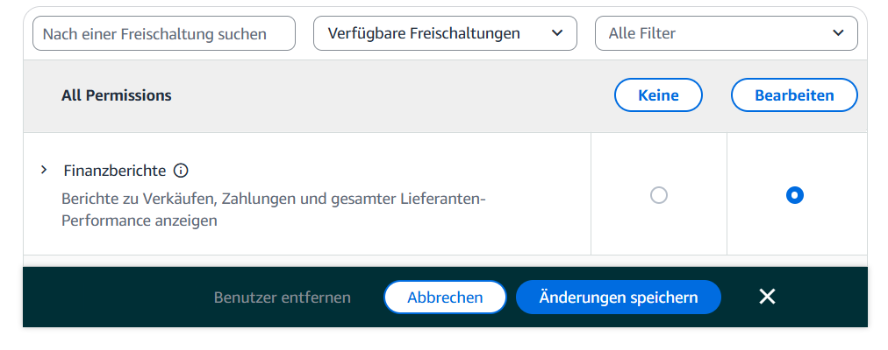

# Add a Vendor Central user for DSP

Sign in to Vendor Central with your administrator account. Have the name and email address supplied by ICONIC ready.

## 1. Open employee management

Click the **gear icon** at the top right of Vendor Central and select **Berechtigungen verwalten** (Manage permissions).

On the **Mitarbeiter verwalten** (Manage employees) page, open **Maßnahmen** (Actions) at the top right. Select **Mitarbeiter einladen** (Invite employee).

## 2. Complete and send the invitation

Enter the contact details supplied by ICONIC in the **Name** and **E-Mail-Adresse** (Email address) fields. Under **Sprache** (Language), select **Deutsch** (German), as shown.

Under **Zugriff auf die Website** (Website access), enable **Vendor Central**. Check the details and click **Einladung senden** (Send invitation).

> **Wait for confirmation.** Continue with the permissions once ICONIC has accepted the invitation and confirmed this to you.

## 3. Open user permissions

After confirmation, return to **gear icon → Berechtigungen verwalten** (Manage permissions). Open the user permissions for the invited ICONIC user.

Under **Kontorolle** (Account role), select **Mitwirkender** (Contributor). In **Access Scope**, set **Vendor Central** to **Bearbeiten** (Edit).

## 4. Set and save DSP permissions

Under **All Permissions**, select **Bearbeiten** (Edit) only for **Finanzberichte** (Financial reports). No other permissions are required for DSP.

Check your selections and click **Änderungen speichern** (Save changes) at the bottom.

> **Done.** Let your ICONIC contact know once you have saved the permissions.