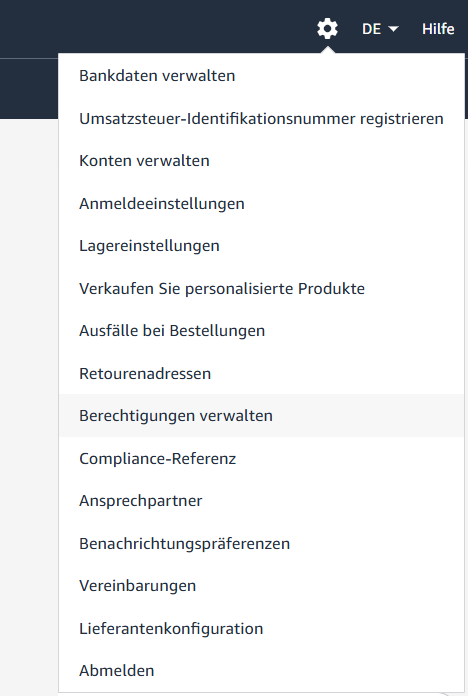
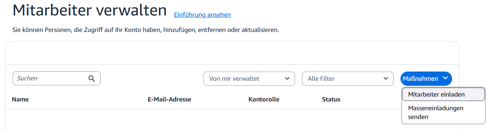
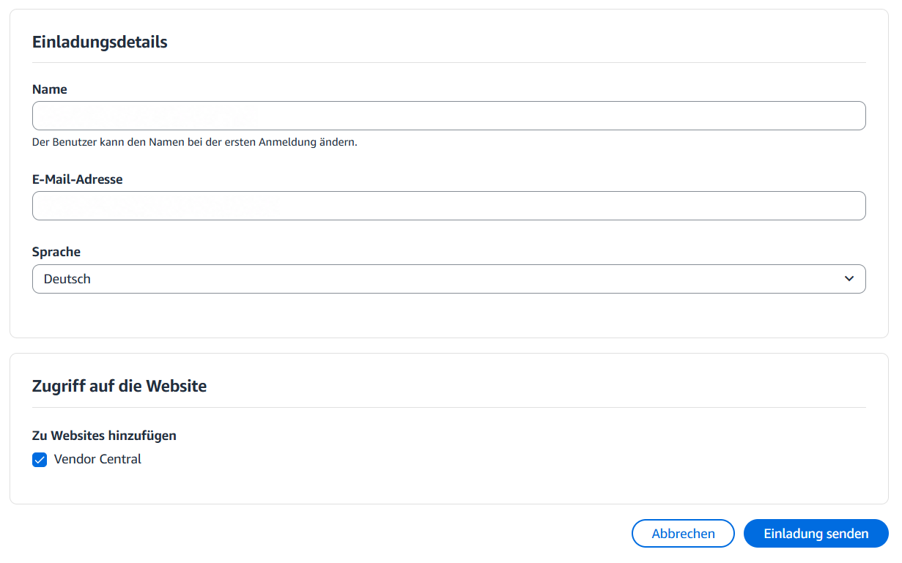
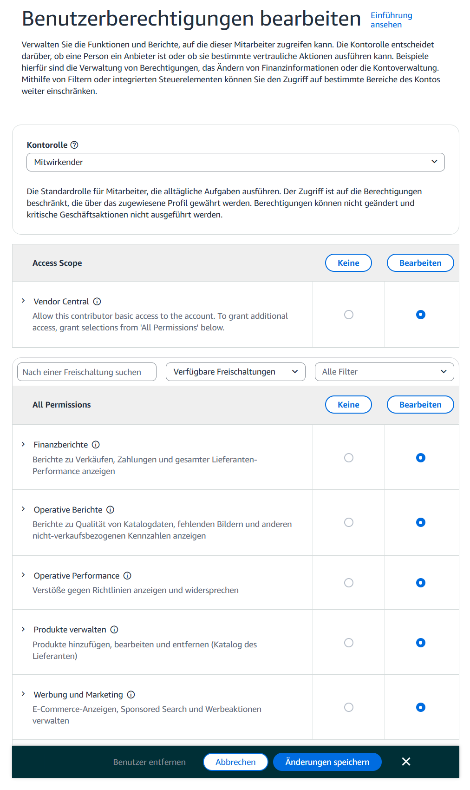

# Nutzer für PPC in Vendor Central hinzufügen

Melden Sie sich für diese Schritte mit dem Administratorkonto Ihres Vendor-Central-Kontos an. Halten Sie den von ICONIC mitgeteilten Namen und die zugehörige E-Mail-Adresse bereit.

## 1. Mitarbeiterverwaltung öffnen

Klicken Sie in Vendor Central oben rechts auf das **Zahnrad** und wählen Sie **Berechtigungen verwalten**.

Auf der Seite **Mitarbeiter verwalten** öffnen Sie oben rechts **Maßnahmen**. Wählen Sie **Mitarbeiter einladen**.

## 2. Einladung ausfüllen und senden

Tragen Sie in die Felder **Name** und **E-Mail-Adresse** die von ICONIC mitgeteilten Kontaktdaten ein. Wählen Sie als **Sprache** die Option **Deutsch**.

Aktivieren Sie unter **Zugriff auf die Website** die Option **Vendor Central**. Prüfen Sie die Angaben und klicken Sie auf **Einladung senden**.

> **Bestätigung abwarten.** Sobald ICONIC die Einladung angenommen und Ihnen dies bestätigt hat, können Sie mit der Vergabe der Berechtigungen fortfahren.

## 3. Benutzerberechtigungen öffnen

Rufen Sie nach der Bestätigung erneut **Zahnrad → Berechtigungen verwalten** auf. Öffnen Sie die Benutzerberechtigungen des eingeladenen ICONIC-Nutzers.

Wählen Sie als **Kontorolle** die Option **Mitwirkender**. Setzen Sie im Bereich **Access Scope** bei **Vendor Central** die Berechtigung **Bearbeiten**.

## 4. PPC-Berechtigungen setzen und speichern

Wählen Sie im Bereich **All Permissions** bei diesen fünf Themen jeweils **Bearbeiten**:

- Finanzberichte
- Operative Berichte
- Operative Performance
- Produkte verwalten
- Werbung und Marketing

Überprüfen Sie die Auswahl und klicken Sie unten auf **Änderungen speichern**.

> **Geschafft.** Geben Sie Ihrem Ansprechpartner bei ICONIC kurz Bescheid, sobald Sie die Berechtigungen gespeichert haben.

